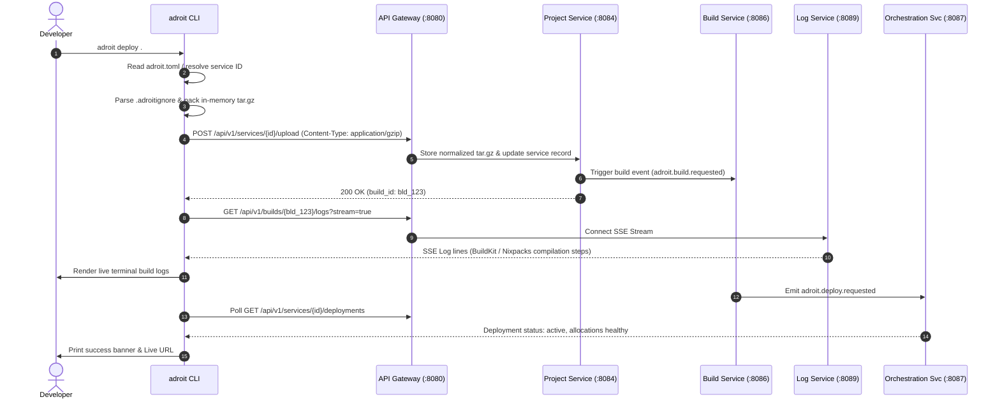
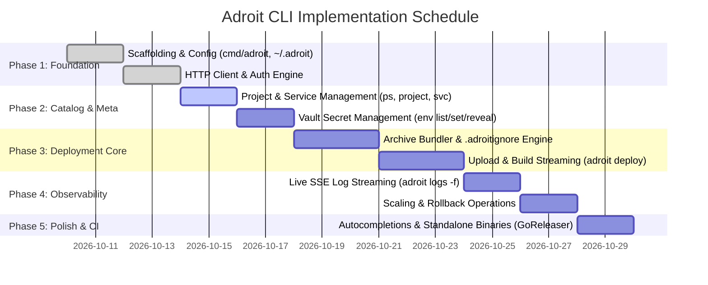

# Adroit CLI (`adroit`) — Production-Ready Implementation Plan

> **Target Component:** `cmd/adroit` & `internal/cli/`  
> **Target Audience:** Application Developers, DevOps Engineers, CI/CD Pipelines  
> **Inspiration:** `flyctl`, `railway`, `vercel`, `gh`, `kubectl`  
> **Status:** Architecture & Implementation Blueprint  

---

## 1. Executive Summary & Architectural Vision

The **Adroit Developer CLI** (`adroit`) is the primary client-side interface for the Adroit Cloud Platform-as-a-Service (PaaS). It bridges local developer workspaces directly to the remote Adroit control plane through the central [API Gateway (:8080)](file:///c:/Users/adeba/OneDrive/Desktop/Adroit-platform/cmd/api-gateway/main.go).

With the backend compute pipeline complete—featuring multi-source ingestion (Git, Archive uploads, Container images), dual build engines (BuildKit & Nixpacks), Nomad orchestration, Vault secrets, Caddy routing, and SSE log streaming—the CLI transforms the platform into an interactive, zero-friction developer experience:

```
┌────────────────────────────────────────────────────────┐
│                   Developer Terminal                   │
│                                                        │
│   $ adroit deploy .                                    │
│   ✓ Discovered Node.js project (package.json)          │
│   ✓ Compressed 1.4 MB context (ignoring node_modules)  │
│   ✓ Uploaded archive to Adroit storage                 │
│   ✓ Nixpacks build plan generated                      │
│   ✓ Container image compiled & pushed to registry      │
│   ✓ Nomad job scheduled (1/1 healthy)                  │
│   🚀 Live at: https://web-e2e.adroit.run               │
└───────────────────────────┬────────────────────────────┘
                            │ HTTPS / REST / SSE
                            ▼
              ┌───────────────────────────┐
              │    API Gateway (:8080)    │
              └─────────────┬─────────────┘
                            │
       ┌────────────────────┼────────────────────┐
       ▼                    ▼                    ▼
 [Project Svc]        [Build Svc]       [Orchestration Svc]
```

---

## 2. Directory Layout & Module Structure

The CLI will follow the platform's standard Go project layout:

```
Adroit-platform/
├── cmd/
│   └── adroit/
│       └── main.go                     # Binary entrypoint (executes root command)
│
├── internal/
│   └── cli/
│       ├── cmd/                        # Cobra commands & flag definitions
│       │   ├── root.go                 # Root command, global flags, version, persistent pre-run
│       │   ├── auth.go                 # login, logout, whoami, token
│       │   ├── init.go                 # Interactive project initialization & adroit.toml creation
│       │   ├── deploy.go               # Local folder archive packaging & deployment lifecycle
│       │   ├── project.go              # list, create, info, delete, switch
│       │   ├── service.go              # list, create, info, delete, restart
│       │   ├── env.go                  # list, set, unset, reveal (Vault secrets integration)
│       │   ├── logs.go                 # SSE real-time log streaming & historical search
│       │   ├── scale.go                # Dynamic replica adjustment & autoscaling status
│       │   ├── domain.go               # Custom domain listing, creation, and DNS verification
│       │   ├── rollback.go             # Reverting deployments to previous historical releases
│       │   ├── status.go               # Combined health, deployment status, and allocation telemetry
│       │   └── completion.go           # Shell autocompletion generators (bash, zsh, fish, powershell)
│       │
│       ├── client/                     # REST & Streaming API Client
│       │   ├── client.go               # HTTP transport, base URL, JWT bearer injection, error unwrapping
│       │   ├── auth.go                 # Auth endpoints (/api/v1/auth/*)
│       │   ├── projects.go             # Projects and catalog (/api/v1/projects/*)
│       │   ├── services.go             # Workloads and archive uploads (/api/v1/services/*)
│       │   ├── builds.go               # Build triggering and build log endpoints (/api/v1/builds/*)
│       │   ├── deployments.go          # Rollout controls and allocations (/api/v1/deployments/*)
│       │   ├── env.go                  # Environment variable CRUD & Vault reveals
│       │   ├── sse.go                  # Robust Server-Sent Events parser for streaming logs
│       │   └── errors.go               # Platform API error decoding (matching pkg/response.ErrorResponse)
│       │
│       ├── config/                     # CLI configuration & active context
│       │   ├── config.go               # ~/.adroit/config.yaml parser & persistence
│       │   ├── context.go              # Active profile, organization, project, and target API URL
│       │   └── project_file.go         # Project-local adroit.toml reader/writer
│       │
│       ├── archive/                    # Local workspace packaging
│       │   ├── pack.go                 # In-memory tar.gz / zip bundler
│       │   ├── ignore.go               # .adroitignore / .gitignore parser
│       │   └── detector.go             # Runtime heuristic detection (Node, Python, Go, Dockerfile)
│       │
│       └── ui/                         # Terminal aesthetics & presentation
│           ├── table.go                # Aligned column tabular formatters
│           ├── spinner.go              # Terminal spinner with status messages
│           ├── color.go                # Semantic color helpers with NO_COLOR & TTY auto-detection
│           ├── prompt.go               # Interactive prompts (input, password, confirm, select)
│           └── printer.go              # Dual-mode output formatter (Human styled vs --json raw mode)
```

---

## 3. Core Dependencies & Libraries

To remain lean, reliable, and consistent with the existing [go.mod](file:///c:/Users/adeba/OneDrive/Desktop/Adroit-platform/go.mod):

| Dependency | Purpose | Rationale |
| :--- | :--- | :--- |
| `github.com/spf13/cobra` | Command-line routing & flags | The industry standard for Go CLIs (`kubectl`, `gh`, `flyctl`, `nomad`). |
| `gopkg.in/yaml.v3` | Configuration serialization | Standard parser for `~/.adroit/config.yaml` and `adroit.toml`. |
| `github.com/briandowns/spinner` | Animated terminal spinner | Provides instant feedback during network I/O, packing, and build polling. |
| `github.com/mattn/go-isatty` | Terminal TTY detection | Automatically disables ANSI color and interactive spinners in CI/CD pipelines. |
| `github.com/olekukonko/tablewriter` | Tabular terminal formatting | Clean, aligned output for `adroit ps`, `adroit env list`, and `adroit projects`. |

---

## 4. Configuration & State Management

The CLI supports a layered configuration model, prioritizing explicit CLI flags over environment variables over configuration files.

### 4.1 Global User Config (`~/.adroit/config.yaml`)
Stored in the user's home directory (`$HOME/.adroit/config.yaml` or `%USERPROFILE%\.adroit\config.yaml`):

```yaml
version: "1"
current_context: "local"

contexts:
  local:
    api_url: "http://localhost:8080"
    token: "eyJhbGciOiJIUzI1NiIsInR5cCI6IkpXVCJ9..."
    active_org_id: "org_9f83a1c2"
    active_org_name: "Default Workspace"
    user_email: "dev@adroit.run"

  production:
    api_url: "https://api.adroit.run"
    token: "adroit_pat_secret..."
    active_org_id: "org_prod_882"
    active_org_name: "Production Corp"
    user_email: "lead@enterprise.com"
```

### 4.2 Project-Local Config (`adroit.toml`)
Placed at the root of a project directory when initialized with `adroit init`:

```toml
[project]
id = "proj_01j7..."
name = "web-api"

[service]
id = "svc_01j7..."
name = "api-service"
type = "web"
port = 8080
source_type = "archive" # "archive" | "git" | "image"

[deploy]
strategy = "rolling" # "rolling" | "canary" | "blue-green"
ignore = [
  ".git",
  "node_modules",
  "dist",
  ".env*",
  "*.tmp"
]
```

### 4.3 Precedence Hierarchy
1. CLI Flag (e.g. `--token <token>`, `--api-url <url>`)
2. Environment Variable (`ADROIT_TOKEN`, `ADROIT_API_URL`, `ADROIT_ORG_ID`)
3. Project Configuration (`adroit.toml`)
4. Global User Context (`~/.adroit/config.yaml`)

---

## 5. Command Specification & User Experience

```
adroit [command] [subcommand] [flags]

Commands:
  auth        Manage CLI authentication and API tokens
  init        Initialize an Adroit project in the current directory
  deploy      Package and deploy the current workload
  ps          List active workloads, health states, and allocations
  service     Manage workload services
  project     Manage multi-tenant projects
  env         Manage environment variables and Vault secrets
  logs        Stream live container or build logs
  scale       Adjust service replica count and autoscaling policies
  domain      Configure custom domains and manage TLS verification
  rollback    Revert a service to a previous deployment release
  version     Display CLI and server version info
```

### 5.1 Global Flags
Every command will support:
- `--json`: Output raw machine-readable JSON (ideal for jq, scripting, and CI/CD).
- `-q, --quiet`: Suppress all non-essential logging and spinners.
- `-v, --verbose`: Print debug logs and raw HTTP request/response payloads.
- `--context <name>`: Switch active context for this command execution.
- `--token <token>`: Override JWT/PAT bearer token.
- `--api-url <url>`: Override target API Gateway URL.
- `--no-color`: Disable all ANSI color codes.

---

## 6. Detailed Workflow Deep-Dives

### 6.1 `adroit deploy`: Zero-Downtime Local Packaging & Rollout
This is the single most critical command in the CLI. It turns any local repository into a live, globally reachable workload:



#### Step-by-Step Execution:
1. **Target Discovery:**
   - Checks for `adroit.toml` in the current directory. If missing, prompts: *"No linked service found. Run 'adroit init' or specify '--service <id>'."*
2. **Local Archive Bundling:**
   - Evaluates default ignore patterns plus `.adroitignore` and `.gitignore`.
   - Recursively packs files into an in-memory `archive/tar.gz` stream.
   - Calculates the SHA-256 digest on the fly.
   - Warns if archive exceeds recommended size limits (>50 MB).
3. **Upload & Ingestion:**
   - Dispatches a streaming `POST /api/v1/services/{id}/upload` with `Content-Type: application/gzip`.
   - The Gateway forwards to [internal/project-service](file:///c:/Users/adeba/OneDrive/Desktop/Adroit-platform/internal/project-service), which normalizes the tarball, saves it in storage, and emits `adroit.build.requested`.
4. **Build Log Follow (`--follow=true` by default):**
   - Automatically attaches to the Build Service log stream.
   - Renders colorized build phases: *[Detect]*, *[Plan]*, *[Compile]*, *[Export]*.
5. **Rollout Supervision:**
   - Once build finishes, queries `GET /api/v1/deployments/{id}` until allocations report `healthy`.
   - Displays final deployment metadata:
     ```
     ✓ Build completed in 8.4s
     ✓ Deployment dep_01j7 scheduled via HashiCorp Nomad
     ✓ 2/2 allocations healthy [canary: none, strategy: rolling]
     
     Service URL: https://my-app.adroit.run
     ```

---

### 6.2 `adroit logs`: Real-Time Streaming & Tail Backfill
Streams application container logs using Server-Sent Events (SSE) from the [Log Service (:8089)](file:///c:/Users/adeba/OneDrive/Desktop/Adroit-platform/cmd/api-gateway/main.go#L161-L170):

```
adroit logs [service-name-or-id] [flags]

Flags:
  -f, --follow          Keep stream open and tail new log events (default false)
  -n, --tail int        Number of historical lines to fetch (default 100)
  --stream string       Filter by stream: 'stdout', 'stderr', or 'all' (default "all")
  --since string        Show logs since timestamp or relative duration (e.g. 5m, 1h)
  --timestamps          Prepend RFC3339 timestamps to each line
```

#### SSE Stream Parser Architecture (`internal/cli/client/sse.go`):
- Connects to `/api/v1/services/{id}/logs?follow=true&tail=100`.
- Implements an HTTP chunked reader that detects `event: log` and `data: {...}` lines.
- Automatically handles network disconnection with exponential backoff and transparent reconnect.
- Graceful exit on `SIGINT` (Ctrl+C).

---

### 6.3 `adroit env`: Zero-Plaintext Vault Secret Management
Interacts directly with the platform's HashiCorp Vault KV v2 architecture:

```
adroit env list                   # Lists keys with masked values (••••••••)
adroit env set KEY=VALUE          # Sets an environment variable or secret
adroit env set --secret KEY=VALUE # Flags variable as Vault secret (value stored in Vault)
adroit env reveal KEY             # Explicitly fetches unmasked secret (triggers audit log)
adroit env unset KEY              # Deletes variable
```

#### Safety Protections:
- Interactive masked input mode (`adroit env set --secret API_KEY`) prevents secrets from being saved in user `.bash_history` / `.zsh_history`.
- Variable scoping flags: `--scope runtime` (default), `--scope build` (compilation time only), `--scope all`.

---

## 7. Terminal UI, Formatting & Presentation (`internal/cli/ui`)

A top-tier PaaS CLI must be visually stunning, responsive, and intuitive:

### 7.1 Styling Guidelines
- **Palette:** 
  - Primary / Branding: Vibrant Cyan / Blue (`#00ADD8`)
  - Success: Bright Green (`✓ [OK]`)
  - Warning: Yellow (`⚠ [WARN]`)
  - Failure: Red (`✗ [ERROR]`)
  - Dim / Metadata: Gray (`#808080`)
- **ASCII Spinners:** Active during HTTP calls, local tarball compression, and Nomad deployment waiting loops.
- **NO_COLOR Support:** Automatically checks `NO_COLOR`, `TERM=dumb`, or `!isatty(stdout)` to disable color sequences.

### 7.2 Human Output vs Machine Output
```bash
# Human Mode (Default)
$ adroit ps
ID           NAME        TYPE   SOURCE    REPLICAS  STATUS   HEALTH   URL
svc_01j78    web-api     web    archive   2/2       active   healthy  https://web-api.adroit.run
svc_01j79    worker      worker git       1/1       active   healthy  -

# Machine Mode (--json)
$ adroit ps --json | jq '.[0].active_url'
"https://web-api.adroit.run"
```

---

## 8. Implementation Roadmap & Milestones



### Milestone Breakdown:

#### Milestone 1: CLI Shell, Configuration & Authentication
- Scaffold `cmd/adroit/main.go` and `internal/cli/cmd/root.go`.
- Implement `~/.adroit/config.yaml` loader and context manager.
- Implement `adroit auth login` (prompt for email/password or browser link), `adroit auth logout`, `adroit auth whoami`.
- Build the core API HTTP client in `internal/cli/client/` with JWT token injection and standard error unwrapping.

#### Milestone 2: Catalog & Environment Operations
- Implement `adroit project [list|create|switch]`.
- Implement `adroit service [list|create|delete]`.
- Implement `adroit ps` to display unified workload status.
- Implement `adroit env [list|set|unset|reveal]` with `--scope` and `--secret` flags.

#### Milestone 3: The Deployment Engine (`adroit deploy`)
- Build the `internal/cli/archive` package:
  - Directory walk with ignore filtering (`.git`, `node_modules`, `venv`, `.env*`).
  - Streaming `tar.gz` buffer creation.
  - Runtime detection logic (Node.js, Go, Python, Dockerfile).
- Implement `adroit init` to generate `adroit.toml`.
- Implement `adroit deploy`:
  - Upload archive to `POST /api/v1/services/{id}/upload`.
  - Stream build logs to stdout.
  - Monitor Nomad allocation rollout and display final public URL.

#### Milestone 4: Observability & Operational Controls
- Implement `internal/cli/client/sse.go` chunked parser.
- Implement `adroit logs [-f|--tail|--stream]`.
- Implement `adroit scale [service] --replicas=N`.
- Implement `adroit rollback [service]`.
- Implement `adroit domain [list|add|verify|remove]`.

#### Milestone 5: Developer Ergonomics & Distribution
- Shell completion generators: `adroit completion [bash|zsh|fish|powershell]`.
- Cross-platform build script using `goreleaser` targeting Windows (`.exe`), Linux (`amd64`, `arm64`), and macOS (`darwin-arm64`, `darwin-amd64`).
- Replace test scripts (`scratch_e2e_test.py`) with an official end-to-end automated CLI integration test suite (`tests/e2e/cli_test.go`).

---

## 9. Verification & Dogfooding Strategy

1. **Unit Testing:**
   - Test archive creation, directory ignoring, and `.adroitignore` matching in `internal/cli/archive/pack_test.go`.
   - Test config reading, writing, and env precedence in `internal/cli/config/config_test.go`.
   - Test HTTP client error mapping and authentication bearer handling using `net/http/httptest`.
2. **Integration Testing:**
   - Stand up the full stack using `go run ./cmd/adroit-dev`.
   - Execute CLI commands directly against `http://localhost:8080`:
     - `adroit auth login`
     - `adroit init`
     - `adroit env set DB_NAME=test`
     - `adroit deploy .`
     - `adroit ps`
     - `adroit logs -n 50`
     - `adroit scale --replicas=3`
3. **CI/CD Integration:**
   - Add automated CLI test step to GitHub Actions ensuring all commands compile cleanly without external CGO dependencies.
